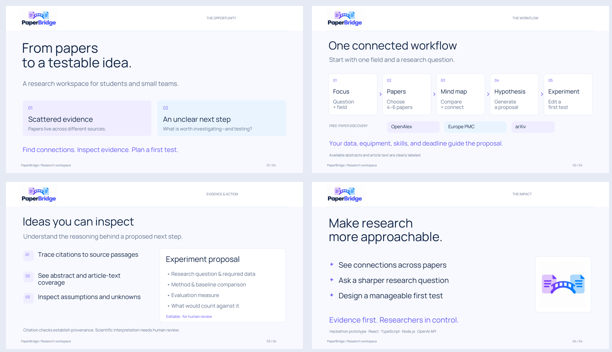

# PaperBridge — One-minute presentation

Four slides, with a 143-word presenter script and approximately one minute of speaking time. The PowerPoint includes speaker notes. The PDF has the same slides for easy viewing and sharing.

- [PowerPoint deck](PaperBridge_1_Minute.pptx)
- [PDF slides](PaperBridge_1_Minute.pdf)
- [Presenter notes](Presenter_Notes.txt)

On a file's GitHub page, use **Download raw file** (the downward arrow) to save it. Downloaded PowerPoint slides can also be imported into Google Slides.

This branch adds presentation files only, based on commit 3955f82. It is a file-delivery branch, not a request to switch the application's version. No app code, configuration, credentials or main branch was changed.

